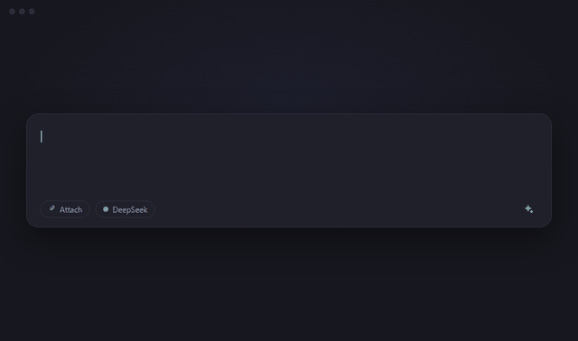

<div align="center">


# dsh-enhance-prompt

**Turn a rough draft into a precise prompt — one click, right inside DeepSeek Harness.**

[English](./README.md) · [简体中文](./README.zh-CN.md)

[](LICENSE)
[](https://www.deepseek.com)
[]()
[](#-privacy--data-flow)

One click turns your draft into a clear, specific prompt. Not happy?
One more click reverts it.

[Features](#-features) · [Installation](#-installation) · [Configuration](#%EF%B8%8F-configuration) · [Privacy](#-privacy--data-flow)



</div>

---

## ✨ Features

| | |
|---|---|
| **One-click rewrite** | One tap on ✨ turns your draft into a clear prompt. |
| **Answers, not questions** | Missing details? It fills them in and marks them "Assume: …" — no back-and-forth. |
| **Instant revert** | Click ↺ to restore. Start typing and the offer disappears. |
| **Cancel anytime** | Click the spinner to cancel; it stops on its own after 60 seconds. |
| **Language preserved** | Chinese stays Chinese, English stays English, mixed stays mixed. |
| **Protects @ references** | Drafts with @ chips are left untouched, so references never break. |
| **Bilingual UI** | Follows the app language, switches live. |
| **Zero footprint** | No storage, no caching, no telemetry. |

## 📦 Installation

Open the plugin installer in DeepSeek Harness and paste **one** of the following:

| Source | Paste this |
|---|---|
| npm <br>_recommended_ | `dsh-enhance-prompt` |
| GitHub | `https://github.com/devilzyl/dsh-enhance-prompt` |
| Local folder | the absolute path to a checkout of this repository |

> [!NOTE]
> If the npm name does not resolve yet, use the GitHub or local-folder source.

After installing or updating the plugin, **refresh the page once** before use.

### Uninstall

Remove the bundle named `dsh-enhance-prompt` from the plugin manager.

## ⚙️ Configuration

Works out of the box. To adjust, edit the plugin row's `config` in the bundle patch:

```yaml
- id: prompt-enhance
  config:
    maxInputChars: 4000      # draft limit; longer drafts return 413
    maxOutputTokens: 1024    # output ceiling for the rewrite
    temperature: 0.4         # optional; omitted means the parameter is not sent
```

## 🔒 Privacy & Data Flow

- **What is sent** — Only the plain text of your draft. No attachments, no files, nothing from other sessions.
- **Where it goes** — To your local Harness, then to the model provider **you** configured. The plugin never goes online by itself and never sees your API keys.
- **What is stored** — Nothing. No files, no cache, no telemetry.
- **Who can call it** — Only a logged-in browser session (401 otherwise); cross-site requests are rejected (403); if the auth service is down, everything is refused (503).

## 📄 License

[MIT](./LICENSE) © dsh-enhance-prompt contributors
