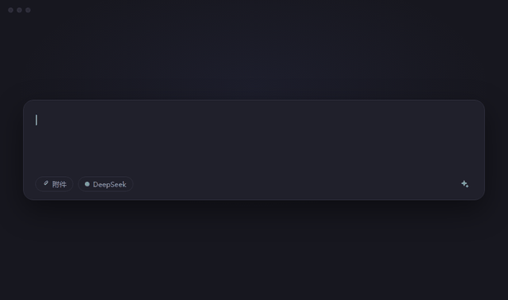

<div align="center">


# dsh-enhance-prompt

**草稿随手写，提示词一键成。**

[English](./README.md) · [简体中文](./README.zh-CN.md)

[](LICENSE)
[](https://www.deepseek.com)
[]()
[](#-隐私与数据流)

安装后，输入框工具行会多出一个 ✨ 按钮。点一下，草稿就变成一份清晰、
具体的提示词；不满意，再点一下就还原。

[功能](#-功能) · [安装](#-安装) · [配置](#%EF%B8%8F-配置) · [隐私](#-隐私与数据流)



</div>

---

## ✨ 功能

| | |
|---|---|
| **一键改写** | 点一下 ✨，草稿就变成清晰的提示词。 |
| **给结果，不提问** | 缺信息就按常理补上，标一句「假设：…」，不反问你。 |
| **随时还原** | 点 ↺ 恢复原文；你一开始打字，还原按钮自动消失。 |
| **可取消、不空等** | 转圈时再点一下就取消；60 秒没结果自动停下。 |
| **语言不变** | 中文还是中文，英文还是英文，混排也保持混排。 |
| **保护 @ 引用** | 草稿里有 @ 引用就先不改，避免把引用弄丢。 |
| **界面双语** | 跟随界面语言，中英文自动切换。 |
| **不留痕迹** | 不存储、不缓存、没有遥测。 |

## 📦 安装

打开 DeepSeek Harness 的插件安装入口，粘贴下面**任意一种**：

| 来源 | 粘贴内容 |
|---|---|
| npm <br>_推荐_ | `dsh-enhance-prompt` |
| GitHub | `https://github.com/devilzyl/dsh-enhance-prompt` |
| 本地目录 | 本仓库检出的绝对路径 |

> [!NOTE]
> 如果 npm 上还搜不到这个包名，就先用 GitHub 或本地目录方式安装。

安装或更新插件后，**刷新一次页面**再使用。

### 卸载

在插件管理器里移除名为 `dsh-enhance-prompt` 的 bundle 即可。

## ⚙️ 配置

开箱即用，无需配置。想调整就改插件补丁里的 `config`：

```yaml
- id: prompt-enhance
  config:
    maxInputChars: 4000      # 草稿字数上限，超出返回 413
    maxOutputTokens: 1024    # 改写结果的长度上限
    temperature: 0.4         # 可选；不填就不随请求发送这个参数
```

## 🔒 隐私与数据流

- **发什么** —— 只有你输入的草稿文字。附件、文件、其他会话的内容，一概不碰。
- **发到哪** —— 先到本机的 Harness，再发给你自己配置的模型服务。插件自己不联网，也拿不到你的 API 密钥。
- **留什么** —— 什么都不留。不写文件、不缓存、没有遥测。
- **谁能用** —— 只有已登录的浏览器能调用；跨站请求一律拒绝；鉴权服务不可用时，所有请求都拒绝。

## 📄 许可证

[MIT](./LICENSE) © dsh-enhance-prompt contributors
